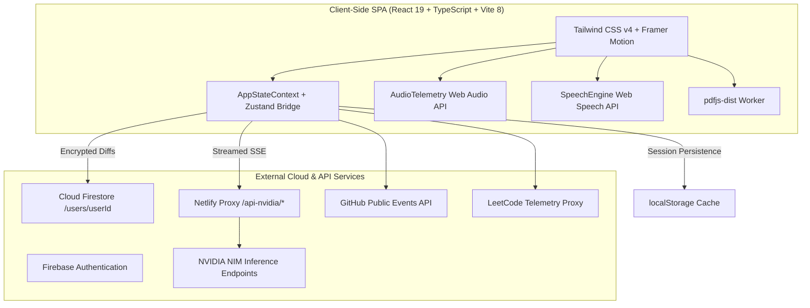

<div align="center">

# 🚀 Placement Cockpit

### *The Personal Operating System for Tech Placements, DSA Mastery & AI Interview Prep*

[](https://react.dev/)
[](https://www.typescriptlang.org/)
[](https://vite.dev/)
[](https://tailwindcss.com/)
[](https://build.nvidia.com/)
[](https://firebase.google.com/)
[](https://vitest.dev/)

<p align="center">
  <b>Comprehensive Curriculum Tracking</b> • 
  <b>Voice-Powered AI Mock Interviews</b> • 
  <b>RPG Skill Constellation</b> • 
  <b>System Design Canvas</b> • 
  <b>ATS Resume Grader</b> • 
  <b>Anti-Vibe-Coding Telemetry</b>
</p>

</div>

---

## 📖 Overview

**Placement Cockpit** is an engineering dashboard designed for Computer Science students and software engineers targeting Tier-1, FAANG, and high-growth product company placements. 

Unlike generic sheets or disconnected tools, Placement Cockpit unifies **curriculum pacing**, **700+ curated DSA problems**, **Full Stack milestone checklists**, **interactive System Design blueprints**, and **NVIDIA NIM-accelerated AI coaching** into a responsive cybernetic web environment.

---

## ⚡ Key Highlights & Modules

### 🎯 1. Mission Control & Adaptive Plans
- **Multi-Pacing Roadmaps**: Choose between **16-Week Mastery**, **100 Days of Code**, **1-Month Sprint**, **2-Month Readiness**, and **3-Month Crash Course**.
- **Dynamic Layouts**: View roadmaps via **Interactive Timelines**, **Modular Grids**, or **Compact Kanban-style Lists**.
- **Pacing Engine**: Pushes daily habits, calculates real-time **Readiness Scores**, and tracks your consistency streak.

### 💻 2. Coding Mastery & DSA Tracker
- **700+ Hand-Curated Problems**: Filtered by NeetCode 150, Striver SDE Sheet, company tags, and topic patterns.
- **Practice Arena**: Standalone problem workbench with a built-in stopwatch, tag filters, and on-demand AI problem breakdowns without polluting your core roadmap progress.
- **Ebbinghaus Spaced Repetition**: Problems scheduled for review at 1, 3, 7, 14, and 30-day intervals to defeat the forgetting curve.

### 🌳 3. RPG Algorithmic Skill Tree
- **Visual Constellation**: Explore a prerequisite tree of core computer science algorithms and data structures.
- **Milestone Unlocks**: Complete parent nodes sequentially to unlock advanced graph, DP, and concurrency patterns, earning **+100 XP** per node.

### 🏛️ 4. Interactive System Design Studio
- **Architecture Canvas**: Drag-and-drop system components (Gateways, Microservices, Kafka queues, Redis caches, Cassandra clusters).
- **Battle-Tested Templates**: Load pre-built reference architectures (TinyURL, Twitter/X Fanout Engine).
- **AI Design Reviewer**: Evaluates your canvas architecture for single points of failure (SPOFs), scalability bottlenecks, and suggests interview follow-ups.

### 🎙️ 5. Voice-Enabled AI Mock Interview Simulator
- **Real-Time Speech Interaction**: Built-in Speech-to-Text (`webkitSpeechRecognition`) and Text-to-Speech audio feedback.
- **Multi-Phase Interviews**: Progresses dynamically through Self-Introduction $\to$ DSA Problem Solving $\to$ Core CS Theory $\to$ Puzzles $\to$ HR rounds.
- **STAR Evaluation Rubrics**: Receive comprehensive scorecards rating Problem Solving, Code Quality, Communication, and localized per-question critiques.

### 📄 6. ATS Resume Grader & Scanner
- **Client-Side PDF Parsing**: In-browser document parsing using `pdfjs-dist` (zero server upload required).
- **ATS Compatibility Scoring**: Benchmark your resume against target roles (Backend, Frontend, Full Stack, ML) with keyword coverage, weak action verb detectors, and quantified impact metrics.

### 🧠 7. Core CS Spaced Repetition Flashcards
- **Active Recall**: Pre-loaded decks for Operating Systems, Database Management Systems (DBMS), and Computer Networks.
- **SuperMemo SM-2**: Algorithmic scheduling based on recall difficulty.
- **AI Deck Generator**: Generate custom topic cards dynamically using NVIDIA NIM models.

### 📊 8. Comprehensive Aptitude Prep Syllabus
- **80+ Topics**: Spanning Quantitative Aptitude, Logical Reasoning, Verbal Ability, Data Interpretation, and Puzzles.
- **Interactive Quizzes**: Instant answer checks, step-by-step formulas, and SVG diagram vector rendering.
- **JSON Question Importer**: Import custom question banks with local persistence.

### 🛡️ 9. Anti-Vibe-Coding Autonomy Monitor
- **Cognitive Muscle Tracker**: Logs self-solved time vs. AI-assisted time.
- **Zone Classifications**: Warns against passive copy-pasting (Red Zone) and promotes first-principles reasoning (Green Zone).

---

## 🛠️ Architecture & Tech Stack



| Layer | Technology |
| :--- | :--- |
| **Framework & Core** | React 19, TypeScript (ESNext), Vite 8 |
| **Styling & Motion** | Tailwind CSS v4, Framer Motion, Lucide Icons |
| **State Management** | Context API (Selector-pattern hook `useAppState`), Zustand Bridge |
| **AI Acceleration** | NVIDIA NIM API (`meta/llama-3.1-70b-instruct`, DeepSeek R1, Nemotron) |
| **Database & Auth** | Google Firebase Authentication, Cloud Firestore (Offline-first fallback) |
| **Document & Markdown** | `react-markdown`, `remark-math`, `rehype-katex`, `dompurify`, `pdfjs-dist` |
| **Audio & Speech** | Pure Web Audio API procedural synthesis, Web Speech API (STT & TTS) |
| **Security & Crypto** | WebCrypto API (PBKDF2 100k rounds + AES-GCM-256) master password encryption |
| **Testing** | Vitest, Testing Library, JSDOM |

---

## ⌨️ Global Keyboard Shortcuts

| Shortcut | Action | Scope |
| :--- | :--- | :--- |
| `Ctrl` + `K` / `⌘` + `K` | Open Command Palette (Quick Jump across 20+ tabs & 700+ problems) | Global |
| `Ctrl` + `T` / `⌘` + `T` | Toggle Dark / Light Theme Mode | Global |
| `Esc` | Close Command Palette, Modals & Slide-out Drawers | Global |
| `Enter` (in Chat) | Send message to AI Technical Mentor | AI Mentor View |
| `Shift` + `Enter` | New line in chat textarea | AI Mentor View |

---

## 🚀 Getting Started

### Prerequisites
- **Node.js**: v18.0.0 or higher
- **npm** or **pnpm**
- **NVIDIA NIM API Key**: Free API key from [build.nvidia.com](https://build.nvidia.com/) *(optional, needed for AI features)*
- **Firebase Project**: *(optional, app runs seamlessly offline in guest mode)*

### 1. Clone the Repository
```bash
git clone https://github.com/MR-1124/Placement-cockpit.git
cd Placement-cockpit
```

### 2. Install Dependencies
```bash
npm install
```

### 3. Configure Environment Variables
Copy the example environment file:
```bash
cp .env.example .env.local
```

Edit `.env.local` with your Firebase project credentials (optional):
```env
VITE_FIREBASE_API_KEY=your_api_key_here
VITE_FIREBASE_AUTH_DOMAIN=your_project.firebaseapp.com
VITE_FIREBASE_PROJECT_ID=your_project_id
VITE_FIREBASE_STORAGE_BUCKET=your_project.appspot.com
VITE_FIREBASE_MESSAGING_SENDER_ID=your_sender_id
VITE_FIREBASE_APP_ID=your_app_id
```

> **Note**: If Firebase credentials are not provided, the application gracefully initializes in **Guest Mode**, persisting all data locally in `localStorage`.

### 4. Run Development Server
```bash
npm run dev
```
Open [http://localhost:5173](http://localhost:5173) in your browser.

---

## 🧪 Testing & Code Quality

```bash
# Run unit test suite
npm run test

# Run tests in watch mode
npm run test:watch

# Run tests with coverage report
npm run test:coverage

# Run ESLint check
npm run lint

# Compile TypeScript and build for production
npm run build
```

---

## 📁 Project Structure

```
placement-cockpit/
├── public/                     # Static icons and curriculum data
├── src/
│   ├── components/             # Reusable UI widgets & layouts
│   │   ├── plan-layouts/       # Timeline, Grid, CompactList layout engines
│   │   ├── CommandPalette.tsx  # Global Ctrl+K command launcher
│   │   ├── FocusMode.tsx       # Pomodoro focus session runner
│   │   ├── MarkdownRenderer.tsx# Markdown + LaTeX math + think-block renderer
│   │   ├── ResumeParser.tsx    # PDF and text resume extractor
│   │   └── SkillDrawerPanel.tsx# Full Stack topic drawer & quiz runner
│   ├── context/                # Global state provider & migrations
│   │   ├── AppStateContext.tsx # Central store, dispatches & Firestore sync
│   │   ├── badgeEngine.ts      # Automatic badge unlock & XP calculation
│   │   └── stateMigrations.ts  # State schema serialization & deserialization
│   ├── data/                   # Curriculum banks & static JSON plans
│   │   ├── plans/              # 5 pre-configured structured study roadmaps
│   │   ├── aptitude_questions/ # Topic-wise aptitude question banks
│   │   ├── aptitudeData.ts     # 80+ aptitude topics & category mapping
│   │   ├── dsaTopics.ts        # 700+ problem catalog with tags and complexities
│   │   └── devCategories.ts    # Frontend, Backend, Database, DevOps skills
│   ├── lib/                    # Helper engines & utilities
│   │   ├── audioTelemetry.ts   # Web Audio API procedural sound engine
│   │   ├── crypto.ts           # WebCrypto AES-GCM-256 encryption
│   │   ├── externalStatsSync.ts# LeetCode & GitHub stats fetcher with TTL cache
│   │   ├── nvidiaApi.ts        # 3-tier fallback NVIDIA NIM caller & SSE streaming
│   │   └── speechEngine.ts     # Web Speech API STT and TTS engine
│   ├── pages/                  # 20+ specialized application views
│   └── types/                  # Centralized domain TypeScript definitions
├── firestore.rules             # Cloud Firestore security rules
├── netlify.toml                # CSP headers, proxy redirects, SPA routing
├── vite.config.ts              # Vite plugins, proxy, and manual chunking
└── package.json
```

---

## 🔒 Security & Privacy

- **Client-Side Master Password**: Encrypt your sensitive NVIDIA NIM API key locally using AES-GCM-256 before saving it to storage.
- **Scoped Firestore Rules**: User documents are strictly scoped to authenticated user IDs (`request.auth.uid == userId`) with data field integrity validation.
- **Privacy-First ATS Parsing**: Resume parsing runs completely inside your browser via web workers — no resume text or personal details are uploaded to third-party file servers.

---

## 🤝 Contributing

Contributions are welcome! Please follow these steps:
1. Fork the repository.
2. Create a feature branch: `git checkout -b feature/amazing-feature`.
3. Commit your changes: `git commit -m "feat: add amazing feature"`.
4. Push to the branch: `git push origin feature/amazing-feature`.
5. Open a Pull Request.

---

## 📄 License

This project is licensed under the **MIT License**.

<div align="center">
  <sub>Built with ❤️ for tech students and future software engineers.</sub>
</div>
