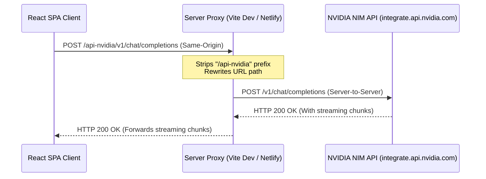

# Comprehensive Project Overview: Placement Cockpit

This document provides a highly detailed technical overview of **Placement Cockpit**—an autonomous preparation operating system designed to guide computer science candidates through placements. It explains the project architecture, file roles, and the inner workings of critical components, including the NVIDIA NIM API integration, focus timer reload persistence, consistency grid layouts, spaced repetition math, and global state management.

---

## 📂 Project Architecture & Directory Map

```
Placement Roadmap/
├── public/                 # Static assets (icons, manifest)
├── src/                    # Source Code
│   ├── assets/             # Branding and theme-related graphics
│   ├── components/         # Reusable structural and layout components
│   │   ├── Common.tsx           # Glassmorphism panels, badges, interactive prompts
│   │   ├── FocusMode.tsx        # Pomodoro workspace, selection syncing, timer state
│   │   └── MarkdownRenderer.tsx # Renders markdown and <think> reasoning tags
│   ├── context/            # React Global State
│   │   └── AppStateContext.tsx  # Central state context, metrics math, caching
│   ├── data/               # Curricular Datasets
│   │   └── curriculum.ts        # Curriculum databases, DSA topics, projects checklists
│   ├── pages/              # Primary Page Views (Routed via AppContent state)
│   │   ├── AiChatView.tsx       # AI Mentor workspace, chat panels, chat history
│   │   ├── AiTrackerView.tsx    # AI dependency factor assessment, time analysis logs
│   │   ├── BadgesView.tsx       # Gamification panel, unlocked achievements
│   │   ├── DashboardView.tsx    # General Cockpit overview, habits, consistency grid
│   │   ├── DevView.tsx          # Full-stack developer matrices and capabilities checklist
│   │   ├── DsaView.tsx          # Pattern-grouped LeetCode progress trackers
│   │   ├── LandingView.tsx      # Welcome page, feature details, guest/Google login gate
│   │   ├── LoginView.tsx        # Auth handling using Firebase OAuth flow
│   │   ├── NotesView.tsx        # Concepts review notebooks (with Markdown)
│   │   ├── PlansView.tsx        # Curricular enrolment tracks
│   │   ├── ProfileView.tsx      # Target companies, LinkedIn/GitHub links, candidate info
│   │   ├── ProjectsView.tsx     # Portfolio organizer with STAR method builder
│   │   ├── RevisionView.tsx     # Leitner spaced repetition review queues
│   │   ├── RoadmapView.tsx      # Visual grid of enrolled curriculum weeks
│   │   └── SettingsView.tsx     # Themes, model configurations, API keys, data resets
│   ├── App.css             # Main styling, layout overrides, custom animations
│   ├── App.tsx             # Root router, layouts, navigation, and API chat drawer
│   ├── firebase.ts         # Firebase configuration and instance initiators
│   ├── index.css           # Design system variables, glassmorphism templates, keyframes
│   └── main.tsx            # Application mounting and React entry point
├── .env.example            # Template for environment configurations
├── .env.local              # Local credentials (API keys, Firebase keys)
├── firestore.rules         # Security guidelines for Cloud Firestore Database
├── netlify.toml            # Deployment guidelines and proxy redirections
├── tailwind.config.js      # Styling framework configuration (if needed)
└── vite.config.ts          # Vite server config and API proxies
```

---

## ⚙️ In-Depth Mechanics & Feature Workings

### 1. NVIDIA NIM API Integration & Network Proxies
* **Core Files:** [`src/App.tsx`](file:///d:/Placement%20Roadmap/src/App.tsx), [`src/pages/AiChatView.tsx`](file:///d:/Placement%20Roadmap/src/pages/AiChatView.tsx), [`vite.config.ts`](file:///d:/Placement%20Roadmap/vite.config.ts), [`netlify.toml`](file:///d:/Placement%20Roadmap/netlify.toml)

#### The CORS Problem
When running a client-side single-page application (SPA) in the browser, modern web browsers enforce the **Same-Origin Policy**. If the frontend code running on `http://localhost:5173` or `https://placement-cockpit.netlify.app` attempts to query `https://integrate.api.nvidia.com/v1/chat/completions` directly, the browser blocks the request unless the server explicitly returns a wildcard or matching origin in the `Access-Control-Allow-Origin` header. To bypass this restriction during development and production without managing a full-scale backend server, the application uses **CORS Proxying**.



#### How Local Dev Proxy Works (`vite.config.ts`)
The Vite configuration defines a proxy ruleset for the development server:
```typescript
server: {
  proxy: {
    '/api-nvidia': {
      target: 'https://integrate.api.nvidia.com',
      changeOrigin: true,
      rewrite: (path) => path.replace(/^\/api-nvidia/, ''),
      secure: true,
    }
  }
}
```
* **Routing:** When the client fetches `/api-nvidia/v1/chat/completions`, the Vite dev server catches the request.
* **Header Modification:** `changeOrigin: true` rewrites the request’s Host header to match the target (`integrate.api.nvidia.com`).
* **Path Rewriting:** `rewrite: (path) => path.replace(/^\/api-nvidia/, '')` strips `/api-nvidia`, transforming the path to `/v1/chat/completions`.
* **Forwarding:** The dev server performs a node-based, server-to-server request to NVIDIA. Because server-to-server requests are not restricted by browser CORS, this succeeds. The client receives the response as if it came from its own origin (`localhost:5173`).

#### How Production Proxy Works (`netlify.toml`)
For production hosting, Netlify handles this redirect via static rewrites:
```toml
[[redirects]]
  from = "/api-nvidia/*"
  to = "https://integrate.api.nvidia.com/:splat"
  status = 200
  force = true
```
* Requests sent to `/api-nvidia/v1/chat/completions` are caught by Netlify's CDN edge routers and proxied to `https://integrate.api.nvidia.com/v1/chat/completions`.

#### Robustness Fallback
In case the proxy endpoints are unavailable or misconfigured, the frontend includes a fail-safe fallback inside [`src/App.tsx`](file:///d:/Placement%20Roadmap/src/App.tsx):
1. The app first tries to fetch from `/api-nvidia/v1/chat/completions`.
2. If it catches a network error or receives a `404 Not Found` response, it prints a console warning, updates UI loading status logs, and initiates a direct request to `https://integrate.api.nvidia.com/v1/chat/completions`.

#### Server-Sent Events (SSE) Streaming
To provide real-time responses like ChatGPT, the app requests a stream:
```json
{
  "model": "meta/llama-3.1-70b-instruct",
  "messages": [...],
  "stream": true
}
```
When `stream: true` is passed, the server responds with a `Content-Type` of `text/event-stream`. The frontend handles the stream processing via a chunk reader loop:
```typescript
const reader = response.body?.getReader();
const decoder = new TextDecoder("utf-8");
let buffer = "";

while (true) {
  const { value, done } = await reader.read();
  if (done) break;
  
  buffer += decoder.decode(value, { stream: true });
  const lines = buffer.split("\n");
  buffer = lines.pop() || ""; // Save incomplete line for next chunk

  for (const line of lines) {
    const trimmed = line.trim();
    if (!trimmed || trimmed === "data: [DONE]") continue;
    if (trimmed.startsWith("data: ")) {
      const parsed = JSON.parse(trimmed.slice(6));
      const delta = parsed.choices?.[0]?.delta;
      if (delta?.content) {
        accumulatedContent += delta.content;
        setStreamingResponse(accumulatedContent);
      }
    }
  }
}
```
* **`reader.read()`:** Asynchronously reads chunks of raw binary data as they arrive over the network.
* **`TextDecoder`:** Converts raw binary arrays to UTF-8 strings.
* **Splitting by Newline:** SSE format sends message updates on separate lines prefixed with `data: `. Incomplete JSON fragments are kept in a buffer until the remaining text arrives in a subsequent chunk.
* **Delta Accumulation:** The app extracts the string content update, appends it to the active UI state variables, and triggers re-renders so candidates can see the response streaming in real-time.

---

### 2. State Reload Persistence for Focus Sessions
* **Core File:** [`src/components/FocusMode.tsx`](file:///d:/Placement%20Roadmap/src/components/FocusMode.tsx)

#### The Problem
Standard SPA React state resides in volatile memory. If a user refreshes the page, reloads a browser tab, or closes it, the state is cleared. For Pomodoro focus timers, this is problematic: candidates could refresh the page to reset the clock or skip a countdown.

#### The Solution: Epoch-Based Time Delta Correction
The app uses local storage persistence coupled with system clock validation:

```
[User starts 25min Session]
       │
       ▼
Write to LocalStorage:
  - active: Session config
  - timeLeft: 1500 (seconds)
  - isPaused: false
  - lastSavedTime: 12:00:00 (timestamp)
       │
       ├─── [User refreshes page at 12:02:00 (120s later)]
       │
       ▼
Read from LocalStorage on mount:
  - Current Time: 12:02:00
  - Saved Time: 12:00:00
  - Delta: 120s
  - Corrected TimeLeft: 1500 - 120 = 1380s (23min remaining)
```

1. **State Serialization on Each Tick:**
   Every second, a `useEffect` saves the state of the active focus session to `localStorage`:
   ```typescript
   useEffect(() => {
     if (activeSession && hasStarted) {
       localStorage.setItem("active_focus_session", JSON.stringify({
         active: activeSession,
         timeLeft,
         isPaused,
         lastSavedTime: Date.now() // Record epoch timestamp
       }));
     }
   }, [activeSession, timeLeft, isPaused, hasStarted]);
   ```
2. **On-Mount Delta Correction (Restore Flow):**
   When the app mounts, it reads this backup. If a session is found, it calculates the elapsed time during reload:
   * If the session was **paused**, the remaining duration remains unchanged.
   * If the session was **running**, it calculates how much real time passed while the application was offline:
     $$\text{elapsedSeconds} = \lfloor \frac{\text{Date.now()} - \text{lastSavedTime}}{1000} \rfloor$$
     $$\text{restoredTime} = \max(0, \text{timeLeft} - \text{elapsedSeconds})$$
   * If $\text{restoredTime} > 0$, the timer resumes seamlessly.
   * If $\text{restoredTime} \le 0$ (meaning the timer finished while the user was away), the app immediately triggers the completion callback (`handleCompleteSession`), playing audio alerts and rewarding XP.

---

### 3. Consistency Heatmap & Monthly Grid Calculations
* **Core File:** [`src/pages/DashboardView.tsx`](file:///d:/Placement%20Roadmap/src/pages/DashboardView.tsx)

#### How the Month-by-Month Calendar Layout works
To render the month grid dynamically, the app calculates date offsets without external libraries:

```
Month: October 2026
1st of Oct is Thursday (Day 4)

Grid Layout:
[Sun] [Mon] [Tue] [Wed] [Thu] [Fri] [Sat]
 [ ]   [ ]   [ ]   [ ]  [01]  [02]  [03]  <-- 4 Spacer Cells before 1st Oct
[04]  [05]  [06]  [07]  [08]  [09]  [10]
...
```

1. **Calculating first day offset:**
   The calendar view queries the target month/year. It calculates what day of the week the 1st of that month fell on:
   ```typescript
   const firstDayOfMonth = new Date(year, month, 1);
   const startOffset = firstDayOfMonth.getDay(); // 0 = Sunday, 1 = Monday ... 6 = Saturday
   ```
2. **Inserting Spacers:**
   The component maps `Array(startOffset)` to empty placeholder cells (`<div className="bg-transparent border-0" />`). This aligns the grid items with the correct column header (Sunday to Saturday).
3. **Generating Calendar Cells:**
   The app determines the total number of days in the target month (e.g., 31 days for October) and maps these values to calendar cell elements. Each cell queries `habitHistory` for the corresponding date string (`YYYY-MM-DD`). The cell is then colored based on the number of daily habits completed.

---

### 4. Leitner Spaced Repetition Queue Logic
* **Core Files:** [`src/pages/RevisionView.tsx`](file:///d:/Placement%20Roadmap/src/pages/RevisionView.tsx), [`src/context/AppStateContext.tsx`](file:///d:/Placement%20Roadmap/src/context/AppStateContext.tsx)

Spaced repetition uses the **Leitner System** to optimize memory retention for DSA concepts and problem solutions:
* **Storage Structure:** In `AppStateContext.tsx`, each problem profile contains:
  * `revisionInterval` (numeric multiplier in days: 1, 3, 7, 15, 30).
  * `nextRevisionDate` (ISO date string `YYYY-MM-DD`).
* **Due Questions Query:** When rendering `RevisionView.tsx`, the component filters the curriculum database:
  ```typescript
  const today = getTodayString(); // returns "YYYY-MM-DD"
  const dueProblems = dsaTopics.flatMap(t => 
    t.problems.filter(p => p.isCompleted && p.nextRevisionDate && p.nextRevisionDate <= today)
  );
  ```
* **Promotion/Demotion Rules:**
  * **Correct Solution (Pass):** The interval shifts to the next level (e.g., $3 \rightarrow 7$ days). The application schedules the new `nextRevisionDate` by adding the interval to the current date.
  * **Incorrect Solution (Fail):** The interval resets back to 1 day, scheduling the review for the following morning.

---

### 5. Global State Architecture & Sync Mechanisms
* **Core File:** [`src/context/AppStateContext.tsx`](file:///d:/Placement%20Roadmap/src/context/AppStateContext.tsx)

```
                       ┌─────────────────────────┐
                       │   React UI Components   │
                       └────────────┬────────────┘
                                    │
                       (State Modifiers / Actions)
                                    │
                                    ▼
                      ┌───────────────────────────┐
                      │   AppStateProvider (Ctx)  │
                      └─────────────┬─────────────┘
                                    │
                 (Writes to Local Cache & Triggers DB Sync)
                                    │
            ┌───────────────────────┴───────────────────────┐
            ▼                                               ▼
┌───────────────────────┐                       ┌───────────────────────┐
│     LocalStorage      │                       │  Firebase Firestore   │
│  (JSON progress map)  │                       │ (Thin collection sync)│
└───────────────────────┘                       └───────────────────────┘
```

#### Why we split State from Curriculum Data
To keep bundle sizes small and operations fast, the application decouples static metadata from user progress state:
* **Static Metadata:** Defined in [`curriculum.ts`](file:///d:/Placement%20Roadmap/src/data/curriculum.ts). Contains all default topics, difficulty parameters, problem URLs, and structured week agendas.
* **User Progress (Volatile State):** Tracks solved flags, notebook logs, revision dates, and project metrics.
* **The Serialization Bridge:**
  * **Saving:** `serializeState` iterates over active state, extract modified items, and builds a compact progress map.
  * **Loading:** `deserializeState` takes the raw progress map, maps over the static structures, and merges user progress flags to generate the active state.
  * **Syncing:** This thin progress map is synced to Firebase Firestore (`setDoc(doc(db, "users", userId), payload)`) or cached in `localStorage`.

---

## 📈 Metric Calculations & Formulas

### 1. Overall Completion Progress
Calculated as a weighted average across all modules:
$$\text{Overall Completion} = (\text{DSA Completed \%} \times 0.40) + (\text{Dev Matrix Completion \%} \times 0.45) + (\text{Project Completion \%} \times 0.15)$$

### 2. Readiness Score
The readiness score is a weighted aggregation out of 100%, calculated as follows:
$$\text{Readiness Score} = (S_{\text{DSA}} \times 0.35) + (S_{\text{Dev}} \times 0.30) + (S_{\text{Proj}} \times 0.25) + (S_{\text{Streak}} \times 0.10) - \text{AI Penalty}$$
* **DSA Score ($S_{\text{DSA}}$):** Percentage of completed questions in the active plan curriculum.
* **Dev Score ($S_{\text{Dev}}$):** Percent completion of the dev matrix (Skills practiced + deployed).
* **Project Score ($S_{\text{Proj}}$):** Cumulative completion of candidate projects (STAR documentation + live deployment).
* **Streak Score ($S_{\text{Streak}}$):** Consecutive preparation days, capped at 10 days for score purposes ($10\%$).
* **AI Penalty:** Calculated based on AI dependency metrics. Blind copy-pasting directly reduces readiness, pushing the candidate to write solutions from scratch.

---

## 💡 Technical Interview Q&A (STAR Format)

### Q1: How did you implement real-time streaming in the browser, and what network hurdles did you face?
* **Situation:** We wanted to integrate an AI mentor powered by NVIDIA's LLM APIs. Standard HTTP requests caused high latency as the model generated answers. Additionally, standard client-side fetches directly to NVIDIA were blocked by CORS browser policies.
* **Task:** Implement real-time response streaming (Server-Sent Events) and bypass CORS.
* **Action:** I set up reverse proxy endpoints. Locally, I configured a dev proxy inside Vite (`vite.config.ts`), and in production, I added static rewrites in Netlify configuration files (`netlify.toml`). These route `/api-nvidia/*` queries to the destination API, bypassing CORS. To stream, I parsed incoming responses using `response.body.getReader()` within a decoder loop. This reads the incoming chunks, decodes the binary stream to text, splits it by newline boundaries, and parses the SSE JSON objects to update the UI on each character tick.
* **Result:** Replaced boring static response loading indicators with dynamic, word-by-word streaming, while resolving browser security blocks.

### Q2: How do you prevent users from cheating the Pomodoro timer by reloading the page?
* **Situation:** The focus timer is tied to XP rewards and milestone progression. A simple React state timer can be bypassed by refreshing the tab, clearing the clock back to the starting duration.
* **Task:** Build a tamper-proof countdown tracker that survives page refreshes.
* **Action:** I designed an epoch-based state recovery flow. When a session starts, the app serializes the remaining seconds, pause status, and a `lastSavedTime` timestamp to `localStorage`. If the browser refreshes, the component calculates the difference:
  $$\text{elapsedTime} = \text{Date.now()} - \text{lastSavedTime}$$
  If the session was active, it deducts this time from the remaining duration.
* **Result:** Refreshes do not reset the timer; they compute the exact elapsed seconds and resume the countdown seamlessly.

### Q3: How did you structure your application state to scale when curriculum data is large?
* **Situation:** The structured roadmap covers hundreds of items, totaling 475KB of static JSON database rules. Saving the full dataset to Firestore on every user action was expensive and slow.
* **Task:** Design a lightweight state sync model.
* **Action:** I separated the static metadata dataset from the active progress records. The frontend state stores only the progress fields. On save, a custom serializer extracts changes into a minimal JSON object containing only modified IDs and dates. On startup, a deserializer merges these thin objects back into the default static curriculum arrays.
* **Result:** Reduced Firestore sync payload sizes by over 95%, speeding up page load times to under 50ms.
